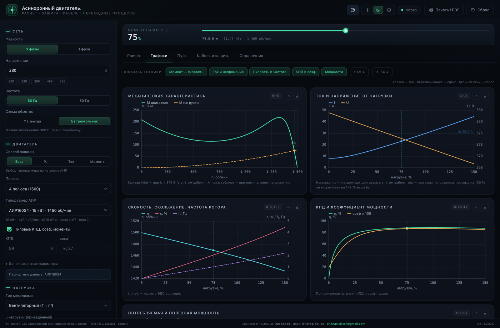
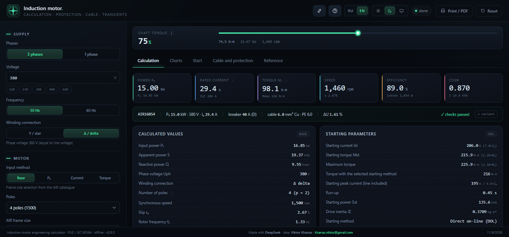
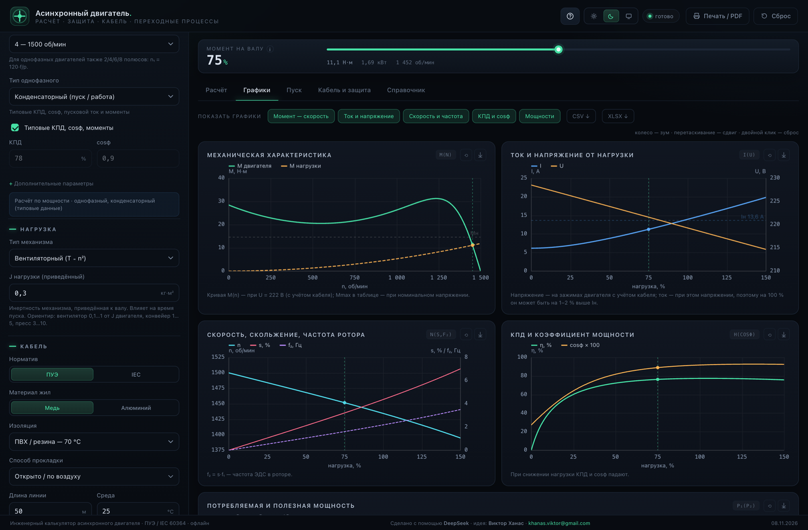
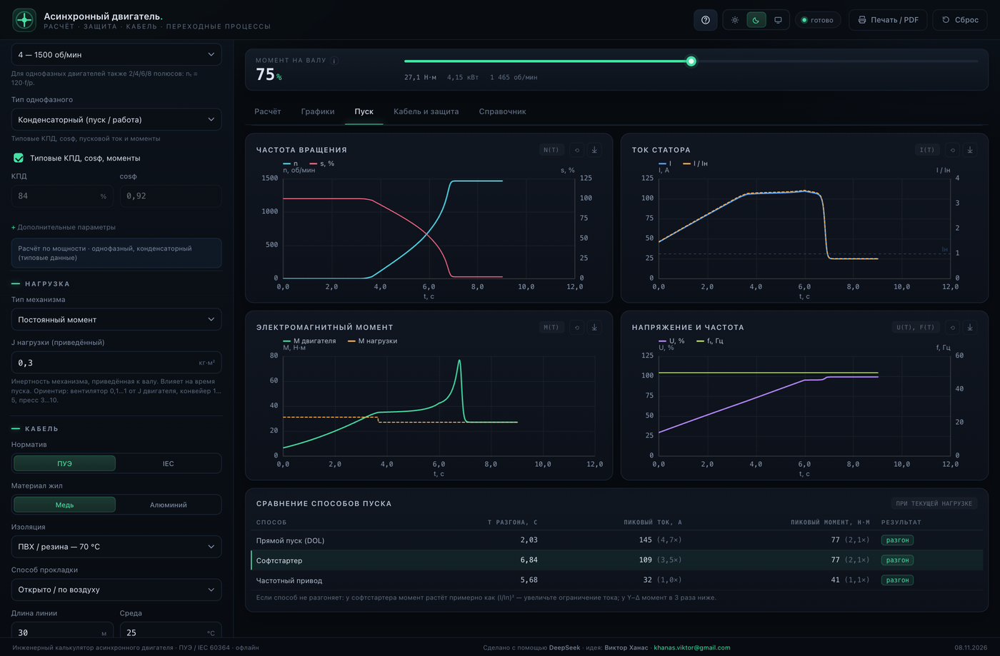
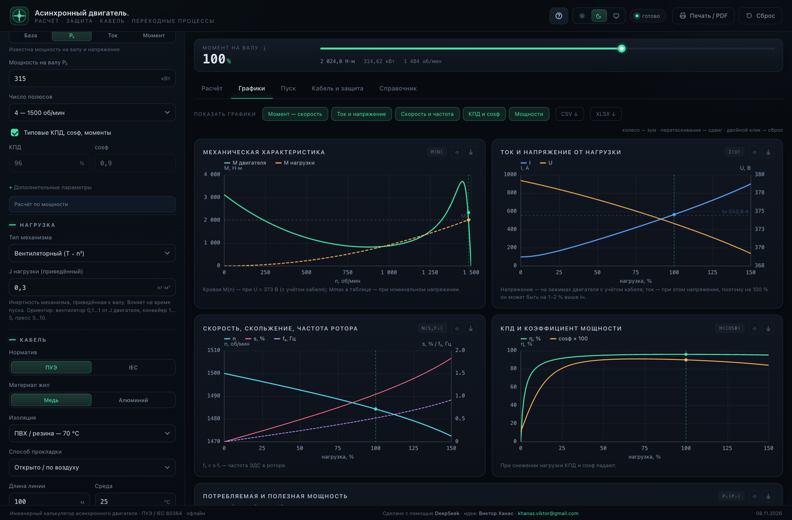
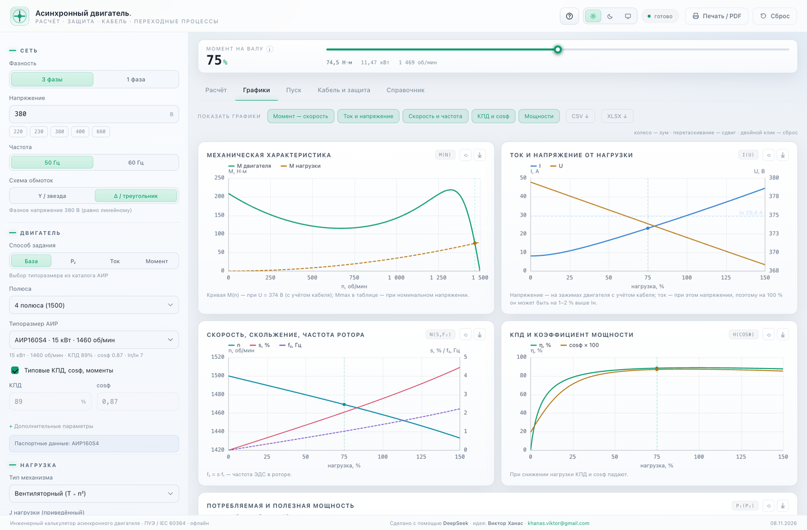
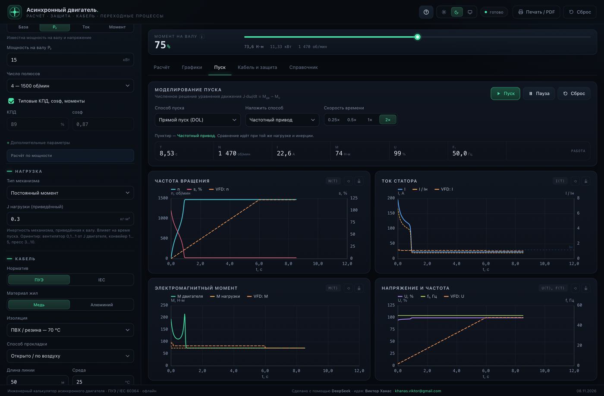

# Induction Motor — Engineering Calculator

[Русский](README.md) · **English**

An offline calculator for induction motors: current, power, torque, cable sizing, protection, time-current curves, performance charts, and starting transients. A single `index.html` — no server, no CDN, no internet.

[](https://github.com/khanasviktor-art/induction-motor-calculator/actions/workflows/ci.yml)
**Version 0.12.1** · MIT · [Open in browser](https://khanasviktor-art.github.io/induction-motor-calculator/) · Windows exe built separately · macOS DMG (Apple Silicon) in the [release](https://github.com/khanasviktor-art/induction-motor-calculator/releases/tag/v0.12.1)



## Who it is for

For engineers and electricians who need a quick check of a motor and its feeder: pick a cable and a protective device, estimate the start and the voltage dip, see whether the start fits the breaker's thermal zone, and export a PDF report. Calculations follow IEC and the Russian ПУЭ rules; catalog data is the АИР series.

## Features

**Motor**
- 54 АИР frame sizes (0.18…315 kW, 2/4/6/8 poles; the large ones are typical values, marked `*`).
- Four input modes: catalog, shaft power P₂, current I, torque M with speed.
- P₁, S, Q, Iн, Iп, Mн/Mп/Mmax, slip, f₂, efficiency, cosφ, inertia, losses, winding temperature.
- Single-phase motors: capacitor, split-phase, PSC — own typical curves up to 7.5 kW (warning above), 2 conductors, 1P breaker.

**Cable**
- Copper/aluminium, PVC/XLPE, 2 or 3 loaded conductors, open/tray/pipe/ground, ambient temperature, grouping.
- IEC or ПУЭ tables, 1…4 parallel cables, PE, derating factors.
- Selection by current-carrying capacity and by voltage drop (running and starting), I²t check at fault current.

**Protection and time-current curves**
- MCB (B/C/D) or MCCB with adjustable trip, Icu, thermal relay, contactor, aM fuse, RCD.
- Curve library: IEK ВА47-29/ВА47-100, CHINT NB1-63/NM1-250, ABB S200/Tmax XT — log-log chart, trip band, cable, upstream device, selectivity.
- **Starting check against the thermal zone**: the start point is compared with the breaker's thermal curve using the rms starting current (∫I²dt/t), not the peak — "passes", "at the edge", "outside the zone". Plus a thermal margin for repeated starts.
- Motor thermal model: hot/cold start, overload class 10/20/30, starts per hour, cooling time constant.

**Charts and starting**
- Mechanical characteristic as torque vs speed (torque horizontal), I/U, n/s/f₂, η/cosφ, powers.
- Four transient charts n(t), I(t), M(t), U(t)/f(t) with zoom and overlay of a second starting method.
- **Simulation time** 2…120 s: the run stops by itself, samples are kept for the whole interval.
- Wheel zoom, pan, double-click reset, PNG of every chart and a selectable chart set for PDF/PNG.

**Export and reports**
- PDF/print: selected charts (by default 5 characteristics + 4 transients + the time-current curve), project name and logo.
- XLSX (7 sheets, charts as images), CSV.
- Project JSON, up to 4 comparison variants, share link `?p=…`.

**Interface**
- Russian and English (RU/EN in the header): units, decimal separator, chart labels, report, XLSX.
- Five color schemes: dark, light, "Graphite", "Ocean", "Warm paper" + "system".
- Sidebar parameter blocks are numbered cards; tooltips on every field; first-run tour; mobile layout.

## Quick start

1. Download `index.html` and open it — it works offline.
2. Or use [GitHub Pages](https://khanasviktor-art.github.io/induction-motor-calculator/).
3. For development:

```bash
npm ci
npm run build     # src/ → index.html
npm test          # build + Playwright
```

If Chrome is not in the default location:

```bash
CHROME_PATH="/path/to/chrome" npm test
```

## Desktop version (Windows and macOS)

The same `index.html` inside an Electron shell: its own window, menu, native save dialogs, and the PDF report through `printToPDF`.

```bash
cd desktop && npm install && cd ..   # once, downloads Electron
npm run desktop                      # run the window
npm run desktop:dist     # build a Windows portable exe
npm run desktop:dist:mac # build macOS DMG (arm64)
```

Windows exe is built on Windows (portable, ~71 MB) and is not stored in git. macOS DMG for Apple Silicon is in the [v0.12.1 release](https://github.com/khanasviktor-art/induction-motor-calculator/releases/tag/v0.12.1). Intel Macs are not supported. Details — [desktop/README.md](desktop/README.md), [docs/WINDOWS.md](docs/WINDOWS.md).

## Language



The **RU / EN** switch is in the header; the choice is stored in `localStorage` and is not put into the `?p=` link. Everything visible changes: interface, tooltips, warnings, canvas labels, report/PDF, XLSX and CSV; units are translated (`кВт` → `kW`, `об/мин` → `rpm`) and the decimal separator becomes a dot.

Translations live in `src/lang-en/*.js` (the key is the Russian string) and are assembled into `src/lang-en.js` by `node tools/i18n-assemble.cjs`. `npm test` fails if a new string has no translation. Rules — [docs/I18N.md](docs/I18N.md).

## Model and checks

- Mechanical characteristic — Kloss formula with a starting-torque correction; rotor current from the power balance including skin effect.
- Thermal model — single-body, with insulation class B/F/H and a heating time constant.
- Starting — numerical solution of `J·dω/dt = Mдв − Mс`; rms starting current `Iэкв = √(∫I²dt/t)`.
- Cable — IEC/ПУЭ tables with derating; voltage drop over the full line impedance.
- Protection — rating, trip setting, Icu, selectivity (coarse), breaker thermal zone.

Formulas and assumptions — [docs/MODEL.md](docs/MODEL.md) (Russian).

## Limitations

Short list; the full one is in [docs/LIMITATIONS.md](docs/LIMITATIONS.md) (Russian).

- This is an **engineering estimate**, not a design certificate. Critical drives need a specialist's calculation.
- Large АИР sizes and single-phase motors are typical data, not nameplate values — enter real data for accuracy.
- Selectivity is coarse (by minimum trip), not coordination over manufacturer curves; the thermal curve uses 5 anchor points.
- Constant power (`M = P/ω`) at zero speed needs infinite torque: DOL, Y–Δ and autotransformer cannot start it without unloading. That is physics, not a bug.
- A 380/660 V motor at 380 V needs Δ; in Y the phase gets 220 V and the torque is ~1/3 — the app warns but does not recompute the loss for a wrong connection.
- Current at 100 % may be 1–2 % above Iн because of the cable drop; cosφ on the chart is at the terminals; Mmax in the table is at rated voltage.
- The capacitor for a single-phase motor is not selected; fault current is not calculated from the network configuration.

## Tests

```bash
npm test              # build + full suite
npm run test:deep     # deep run only (629 checks)
```

- Node unit tests for the core (`tests/unit.mjs`, 44 checks) plus Playwright in real Chrome: 15 static scenarios, 5 starting methods, overlay, single phase, tour, tooltips, themes, XLSX/CSV, project, report, zoom, mobile drawer.
- `tests/deep.mjs` — 629 checks: 58 combinations of phases × modes × starting methods × MCB/MCCB, physical invariants, curves and thermal zone, exports, persistence, boundaries and errors, UI, performance, and numeric baselines of 15 states.
- i18n: no Cyrillic left in EN mode (tabs, tooltips, canvas, report, XLSX); switching back to RU restores the text.
- `tests/desktop.mjs` — 24 checks of the packaged exe, including real CSV/XLSX/PNG/PDF files on disk.

Status: all tests pass in CI on Node 22. Details — [docs/TESTING.md](docs/TESTING.md) (Russian).

## Development

- Sources in `src/`; `index.html` is built by `build.mjs` and committed. Do not edit it by hand.
- Debug: `index.html?debug=1` → `__mcDebug.state / rep / charts / sim / compare`.
- Style: ES2020, IIFEs, no runtime dependencies, LF. CI checks the build, the committed `index.html` and the dictionary.

Commands and layout — [docs/DEVELOPMENT.md](docs/DEVELOPMENT.md), agent contract — [docs/AGENTS.md](docs/AGENTS.md) (Russian).

## Documentation

| Document | Contents |
|---|---|
| [docs/ARCHITECTURE.md](docs/ARCHITECTURE.md) | modules, data flow, state, charts, build |
| [docs/MODEL.md](docs/MODEL.md) | formulas, assumptions, reference values |
| [docs/LIMITATIONS.md](docs/LIMITATIONS.md) | important limitations and what to do |
| [docs/DEVELOPMENT.md](docs/DEVELOPMENT.md) | build, tests, debugging, adding data |
| [docs/TESTING.md](docs/TESTING.md) | test matrix, baselines, CI |
| [docs/DATA.md](docs/DATA.md) | catalog schema, adding motors |
| [docs/I18N.md](docs/I18N.md) | i18n layer, dictionary, translation rules |
| [docs/WINDOWS.md](docs/WINDOWS.md) | Windows build: feature parity, shell, acceptance checklist |
| [desktop/README.md](desktop/README.md) | desktop shell: build, bridge, limitations |
| [docs/AGENTS.md](docs/AGENTS.md) | contract for AI agents, pitfalls |
| [docs/PUBLISHING.md](docs/PUBLISHING.md) | repository name, description, topics, Pages, release |
| [CONTRIBUTING.md](CONTRIBUTING.md) | how to send a PR |
| [CHANGELOG.md](CHANGELOG.md) | version history |

The documentation is written in Russian.

## Layout

```
index.html              built application (committed)
src/
  index.html            markup
  style.css             styling: schemes on [data-theme], tone on [data-tone], responsive
  shell.js              desktop bridge (with a browser fallback)
  data.js               АИР motors, cables, devices, curves
  engine.js             steady state
  sim.js                transients, sampling for the report
  charts.js             canvas: zoom, PNG, reference lines, markers
  vtc.js                curve library, thermal trip time
  xlsx.js               XLSX without dependencies
  i18n.js               RU/EN: t()/tf()/tHtml(), nf()
  lang-en.js            RU→EN dictionary (assembled from src/lang-en/)
  lang-en/              dictionary chunks
  app.js                state, UI, report, projects
build.mjs               inlines src/ → index.html
desktop/                Electron shell (main.js, preload.js, save.js, app/)
tools/                  i18n, shell build, icon
tests/                  Playwright: engine, smoke, charts, features, i18n, deep, desktop
docs/                   documentation and screenshots
.github/                CI and issue/PR templates
```

## Screenshots

| Single-phase calculation | Soft starter, single phase |
|---|---|
|  |  |

| 315 kW | Light theme |
|---|---|
|  |  |

DOL + VFD overlay:



## License and authors

MIT — see [LICENSE](LICENSE). Copyright (c) 2026 Viktor Khanas.

Built with **DeepSeek**. Idea and inspiration — **Viktor Khanas**, [khanas.viktor@gmail.com](mailto:khanas.viktor@gmail.com).
