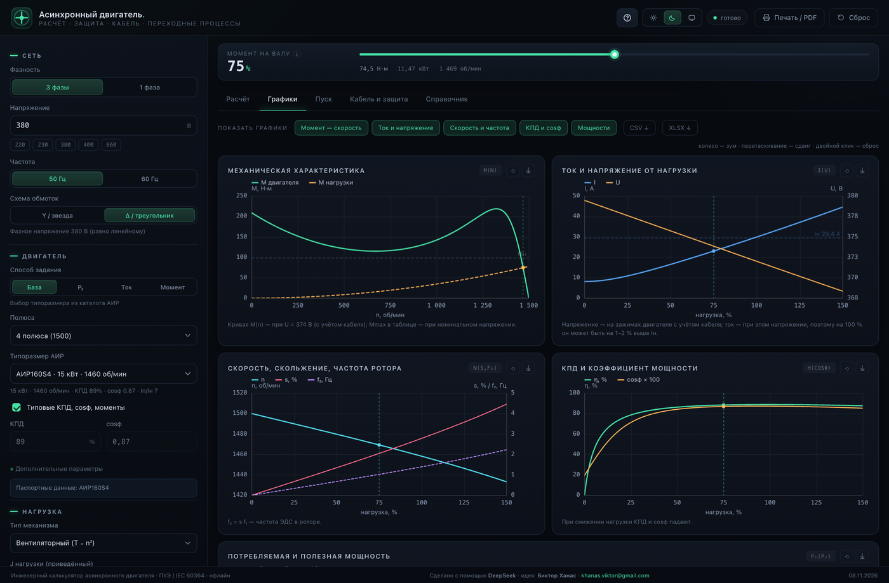
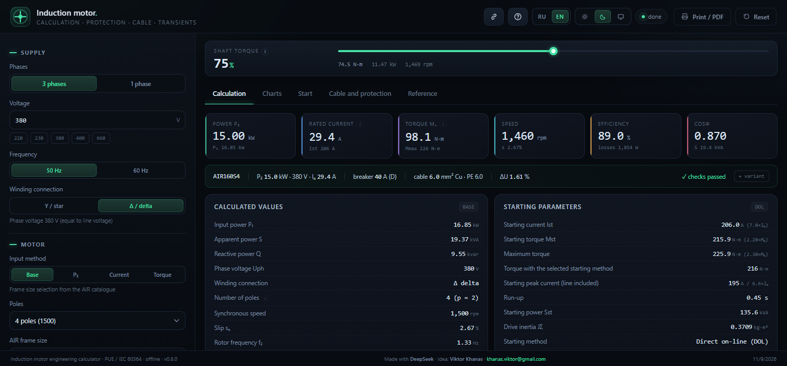
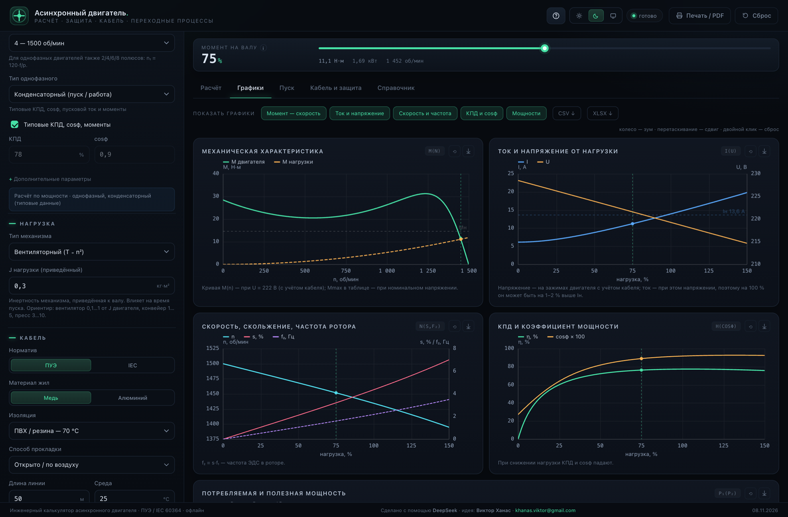
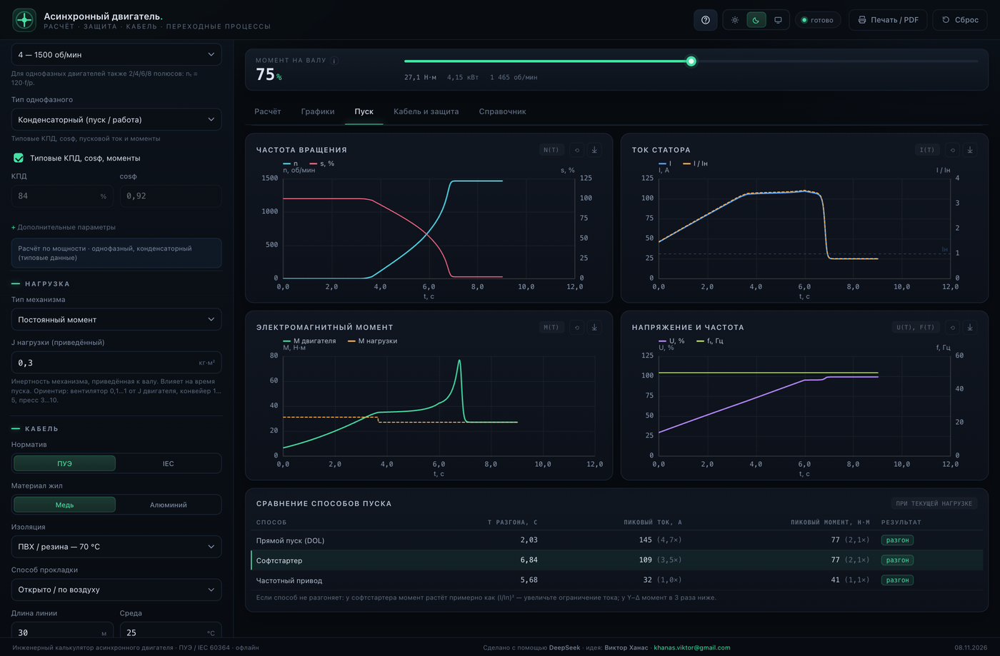
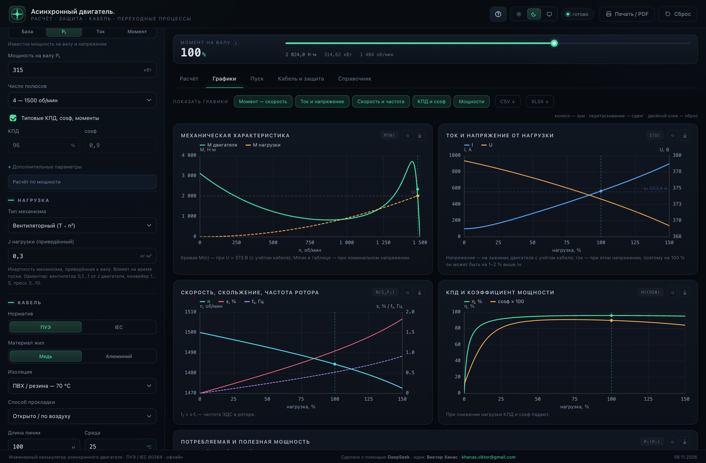
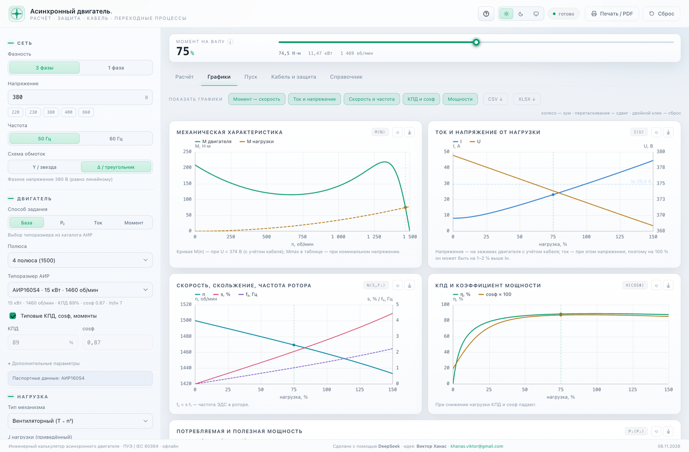
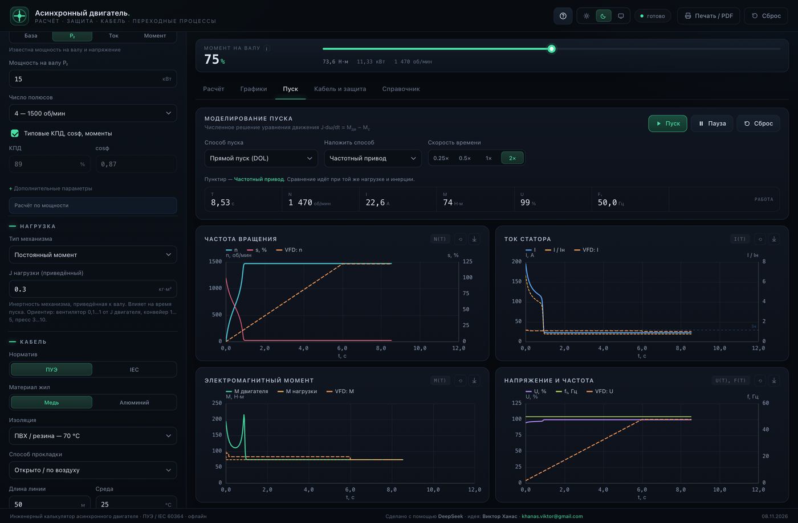

# Асинхронный двигатель — инженерный калькулятор

Офлайн-приложение для расчёта асинхронного двигателя: ток, мощность, момент, кабель, защита, графики характеристик и переходные процессы пуска. Один HTML-файл, без сервера, CDN и интернета.

**Версия:** 0.7.6 · **Лицензия:** MIT · **Сборка:** `index.html` (~280 КБ) · [](https://github.com/khanasviktor-art/induction-motor-calculator/actions/workflows/ci.yml)

### ВТХ по каталогам

В версии 0.7.0 добавлена библиотека ВТХ: **IEK ВА47-29 / ВА47-100**, **CHINT NB1-63 / NM1-250**, **ABB S200 / Tmax XT**. Вкладка «Кабель» → «ВТХ: защита и пуск»: выбор серии, кривой B/C/D/K/Z или уставки MCCB, лог-лог график, точка пуска, кабель, вышестоящая защита и селективность. Источники и оговорки — [docs/VTC_SOURCES.md](docs/VTC_SOURCES.md).

### Тепловой режим

В «Пуск» → «Тепловой режим»: горячий/холодный пуск, начальный нагрев, класс перегрузки 10/20/30, пусков в час, постоянная охлаждения. Время до предела температуры учитывает начальную температуру и класс.

### Что нового в 0.6.0

- Автосхема **Y/Δ** и пересчёт момента/тока при неверном соединении.
- Бейдж «оценка» для однофазных >7,5 кВт.
- Ссылка на расчёт (`?p=...`) и кнопка «Поделиться».
- Своя кривая нагрузки и разгрузка/сцепление на пуске.
- Название объекта и логотип в PDF, графики картинками в XLSX.
- Таблицы данных под графиками, aria и фокус-ловушка в drawer/туре.
- Однофазные данные до 11 кВт, юнит-тесты ядра, CI на Node 22.



## Быстрый старт

1. Скачайте `index.html` и откройте двойным щелчком — всё работает офлайн.
2. Или откройте [GitHub Pages](https://khanasviktor-art.github.io/induction-motor-calculator/) (после включения Pages: **Settings → Pages → Deploy from branch → main / (root)**).
3. Для разработки:

```bash
npm ci
npm run build          # src/ → index.html
npm test               # сборка + Playwright
```

Если Chrome не в стандартном месте:

```bash
CHROME_PATH="/path/to/chrome" npm test
```

Подробнее — [docs/DEVELOPMENT.md](docs/DEVELOPMENT.md). Публикация (имя репозитория, описание, topics, Pages, релиз) — [docs/PUBLISHING.md](docs/PUBLISHING.md).

## Возможности

**Расчёт**
- 54 типоразмера АИР (0,18…315 кВт, 2/4/6/8 полюсов; крупные — типовые, `*`).
- Четыре способа задания: каталог, мощность P₂, ток I, момент M и скорость.
- P₁, S, Q, Iн, Iп, Mн/Mп/Mmax, скольжение, f₂, КПД, cosφ, J, потери, температура.
- Рабочая точка 0…150 % нагрузки в реальном времени.
- Однофазные двигатели: конденсаторный, split, PSC — отдельные типовые кривые до 7,5 кВт (выше — предупреждение), 2 жилы, 1P, DOL/софтстартер/ПЧ.

**Кабель**
- Медь/алюминий, ПВХ/XLPE, 2/3 нагруженные жилы, открыто/лоток/труба/земля, температура, группировка.
- ПУЭ или IEC, 1…4 параллельных кабеля, PE.
- Выбор по нагреву, ΔU в работе и просадке при пуске.
- Проверка I²t при КЗ.

**Защита**
- MCB (B/C/D) или MCCB с отсечкой, Icu, тепловое реле, контактор, aM, УЗО.
- Проверка отсечки с учётом способа пуска и грубая селективность.

**Графики**
- M(n), I/U, n/s/f₂, η/cosφ, мощности.
- Зум/пан, PNG, CSV, XLSX всех таблиц.
- Наложение второго способа пуска на графики переходных процессов.

**Переходные процессы**
- DOL, Y–Δ, софтстартер, ПЧ, автотрансформатор.
- Живой режим, сравнение способов, осциллограммы n/I/M/U/f.

**Интерфейс**
- Русский и английский интерфейс: переключатель RU/EN в шапке, выбор запоминается, английские единицы и десятичная точка.
- Светлая/тёмная/авто тема, мобильная версия.
- Мастер-тур при первом запуске (повтор — «?»).
- Подсказки ко всем полям, включая J нагрузки.
- Проект JSON, PDF-отчёт с графиками, варианты для сравнения.

## Язык / Language



Переключатель **RU / EN** — в шапке справа, рядом с темой. Выбор хранится в
`localStorage` (`motor-calc-lang`) и в ссылку `?p=` не попадает: открыв проект,
вы увидите его на своём языке.

При переключении меняется всё видимое: интерфейс, подсказки, предупреждения,
подписи на графиках (canvas), печатный отчёт/PDF, листы XLSX и CSV. В английском
режиме единицы переводятся (`кВт` → `kW`, `об/мин` → `rpm`, `Н·м` → `N·m`,
`мм²` → `mm²`), десятичный разделитель — точка (`11.47 kW`), числа с разрядами
через запятую (`1,469 rpm`).

Почему так: калькулятор читают и по ПУЭ, и по IEC. Инженеру важно видеть
привычные обозначения, но при этом одну и ту же физику и одни и те же цифры —
поэтому переводится только представление, расчёты и данные остаются общими.
Документация (`docs/`, README) — только на русском: это инженерные заметки,
а не часть интерфейса.

Переводы лежат в `src/lang-en/*.js` (ключ — русская строка, значение —
английская), собираются в `src/lang-en.js` командой
`node tools/i18n-assemble.cjs`. Не хватает перевода — добавьте строку в нужный
кусок и пересоберите; тест `tests/i18n.mjs` проверяет, что в EN-режиме
кириллицы не остаётся. Правила перевода и термины — [docs/I18N.md](docs/I18N.md).

## Термины

- **Клосс** — классическая формула механической характеристики асинхронного двигателя:
  `M = 2·Mmax / (s/s_cr + s_cr/s)`.
  Она связывает момент со скольжением через максимальный момент `Mmax` и критическое скольжение `s_cr`. В программе `s_cr` находится из номинального скольжения и `Mmax/Mн`, а к формуле добавляется `boost·s³`, чтобы кривая проходила через пусковой момент. Это инженерная аппроксимация, а не заводской тест.
- **s_cr** — критическое скольжение, точка максимума момента.
- **Mmax** — максимальный (опрокидывающий) момент.
- **DOL** — прямой пуск от сети.
- **ПЧ** — частотный привод (VFD).
- **PSC** — однофазный двигатель с постоянно включённым конденсатором.
- **m_st / m_max / k_st** — кратности пускового момента, максимального момента и пускового тока.
- **ΔU** — падение напряжения в линии.

Подробнее — [docs/MODEL.md](docs/MODEL.md).

## Документация

| Документ | Что внутри |
|---|---|
| [docs/ARCHITECTURE.md](docs/ARCHITECTURE.md) | модули, поток данных, состояние, графики, сборка |
| [docs/MODEL.md](docs/MODEL.md) | формулы, допущения, эталоны |
| [docs/LIMITATIONS.md](docs/LIMITATIONS.md) | **важные ограничения** и что делать |
| [docs/DEVELOPMENT.md](docs/DEVELOPMENT.md) | сборка, тесты, отладка, добавление данных |
| [docs/TESTING.md](docs/TESTING.md) | матрица тестов, эталонные значения, CI |
| [docs/DATA.md](docs/DATA.md) | схема справочников, добавление двигателей |
| [docs/I18N.md](docs/I18N.md) | язык интерфейса: i18n-слой, словарь, правила перевода |
| [docs/WINDOWS.md](docs/WINDOWS.md) | Windows-версия: состояние, паритет функций, обёртка, чек-лист приёмки |
| [desktop/README.md](desktop/README.md) | настольная оболочка: сборка, мост `MC_BRIDGE`, ограничения |
| [docs/AGENTS.md](docs/AGENTS.md) | контракт для AI-агентов, ловушки |
| [docs/PUBLISHING.md](docs/PUBLISHING.md) | имя репозитория, description, topics, Pages, релиз |
| [CONTRIBUTING.md](CONTRIBUTING.md) | как отправить PR |
| [CHANGELOG.md](CHANGELOG.md) | история версий |

## Структура

```
index.html              собранное приложение (коммитится)
src/
  index.html            разметка
  shell.js              мост к настольной оболочке (с браузерным фолбэком)
  style.css             оформление, темы, адаптив
  data.js               АИР, кабели, аппараты
  engine.js             установившийся режим
  sim.js                переходные процессы
  charts.js             canvas, зум, PNG
  xlsx.js               XLSX без зависимостей
  i18n.js               переключение RU/EN, t()/tf()/tHtml()
  lang-en.js            словарь RU→EN (собирается из src/lang-en/)
  lang-en/              куски словаря по темам
  app.js                состояние, UI, отчёт, проекты
build.mjs               инлайнит src/ → index.html
desktop/                Electron-оболочка (main.js, preload.js, save.js, app/)
tools/                  i18n, сборка оболочки, иконка
tests/                  Playwright: smoke, static, transient, features
docs/                   документация и скриншоты
.github/                CI и шаблоны issue/PR
```

## Настольная версия (Windows)

Тот же `index.html` в оболочке Electron: своё окно, меню, сохранение файлов через
системные диалоги и PDF отчёта через `printToPDF`. Расчёт, интерфейс и тесты
остаются общими с веб-версией — оболочка содержит только системную часть.

```bash
cd desktop && npm install && cd ..   # один раз, скачивает Electron
npm run desktop                      # запустить окно
npm run desktop:dist                 # собрать portable exe в desktop/dist
```

Подробности — [desktop/README.md](desktop/README.md) и [docs/WINDOWS.md](docs/WINDOWS.md).
Готовый exe: `desktop/dist/MotorCalculator-0.9.0-win-x64.exe` (в git не хранится).

## Тесты

```bash
npm test
```

- 15 статических сценариев (3ф/1ф, 2/6/8 полюсов, 60 Гц, 315 кВт, 150 %, 1ф 11 и 15 кВт).
- 5 способов пуска + наложение + 1 фаза.
- Тур, подсказки, темы, XLSX/CSV, проект, отчёт, зум/PNG, мобильный drawer.
- Переключение языка: в EN-режиме на всех вкладках, в подсказках, на графиках,
  в отчёте и в XLSX не остаётся кириллицы, выбор переживает перезагрузку,
  возврат на RU восстанавливает русский текст.
- Глубокий прогон (`tests/deep.mjs`): 58 комбинаций фаз × режимов × способов пуска ×
  MCB/MCCB, физические инварианты, ВТХ, экспорты (PNG/CSV/XLSX/отчёт), персистентность
  (state, проект, варианты, share-ссылка), границы и ошибки, интерфейс, производительность
  и эталоны чисел 15 состояний (`tests/fixtures/deep-baseline.json`).
- Проверяется совпадение данных графиков с расчётом, рабочая точка, `tStart`/пики, монотонность.
- Для Windows-версии — проверка **упакованного** приложения по CDP:
  `APP_EXE="C:\\dist\\MotorCalculator.exe" npm run test:desktop`; приёмочный
  чек-лист и подводные камни обёртки — [docs/WINDOWS.md](docs/WINDOWS.md).

Текущий статус: **все тесты проходят**. Подробности — [docs/TESTING.md](docs/TESTING.md).

## Важные ограничения

Кратко; полный список — [docs/LIMITATIONS.md](docs/LIMITATIONS.md).

- Это **инженерная оценка**, а не проектное заключение. Для ответственных приводов нужен расчёт специалиста.
- Модель двигателя — формула Клосса (классическая аппроксимация механической характеристики) + добавка на пусковой момент; ток — по балансу мощности; тепловая модель однотельная.
- Крупные АИР и однофазные — **типовые** данные, не паспорт. Для точности вводите паспортные значения.
- Кабель/аппараты — справочные таблицы; селективность — грубая, не по время-токовым кривым.
- Ток при 100 % может быть на 1–2 % выше Iн из-за падения в кабеле; cosφ на графике — на зажимах.
- Кривая M(n) — при фактическом U рабочей точки; Mmax в таблице — при номинальном.
- Софтстартер с малым ограничением тока может честно не разгонять тяжёлую нагрузку; Y–Δ/AT могут дать бросок при переключении.
- **Постоянная мощность** (`M = P/ω`) при нулевой скорости требует бесконечного момента: прямой пуск, Y–Δ и автотрансформатор без разгрузки/сцепления не разгонят; ПЧ тоже нужна разгрузка. Это не баг, а физика; для реального механизма выбирайте его настоящую кривую нагрузки.
- Для двигателя **380/660 В при 380 В нужна Δ**; в Y на фазе 220 В и момент ~1/3. Приложение предупреждает, но модель не пересчитывает потерю момента по неверной схеме.
- Конденсатор для однофазного не подбирается; КЗ по схеме сети не считается.

## Разработка

- Исходники — `src/`; `index.html` генерируется и коммитится.
- Не редактируйте `index.html` вручную.
- Отладка: `index.html?debug=1` → `__mcDebug`.
- Стиль: ES2020, IIFE, без runtime-зависимостей, 2 пробела, LF.
- CI проверяет сборку, `git diff -- index.html` и тесты.

Подробнее — [docs/DEVELOPMENT.md](docs/DEVELOPMENT.md) и [docs/AGENTS.md](docs/AGENTS.md).

## Скриншоты

| Однофазный расчёт | Софтстартер 1ф |
|---|---|
|  |  |

| 315 кВт | Светлая тема |
|---|---|
|  |  |

Наложение DOL + ПЧ:



## Лицензия и авторы

MIT — см. [LICENSE](LICENSE). Copyright (c) 2026 Виктор Ханас.

Сделано с помощью **DeepSeek**. Идейный вдохновитель — **Виктор Ханас**, [khanas.viktor@gmail.com](mailto:khanas.viktor@gmail.com).

Если нужна другая лицензия — замените `LICENSE` и раздел в README.

## English summary

An offline single-file calculator for induction motors: current, power, torque, cable sizing, protection, performance charts, and starting transients. No runtime dependencies, no CDN, works from `file://` or GitHub Pages.

Build: `npm ci && npm run build` → `index.html`. Tests: `npm test` (Playwright, `CHROME_PATH` required if Chrome is not in the default location). See `docs/` for architecture, model, limitations, data, testing, and agent instructions. MIT license.

> Engineering estimate only. Verify against nameplate data, manufacturer catalogs, and applicable standards (IEC/ПУЭ). Not a substitute for a professional design.
